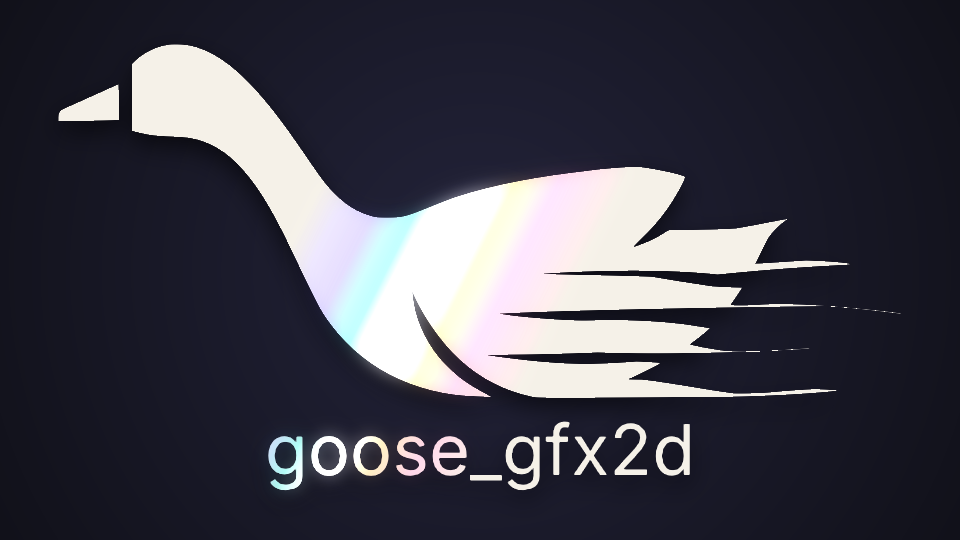

# goose_gfx2d



2D drawing for the [Goose](https://github.com/aardappel/goose) programming
language, on [goose_gfx](https://github.com/aardappel/goose_gfx). It provides
anti-aliased shapes (rectangles, rounded rectangles, circles, ellipses, arcs,
lines, polygons and Bézier paths), fills and strokes, solid, gradient and
image paints with blend modes, 2D transforms, clipping, color math, and
scalable SDF text. All of it is drawn through `gfx` and SDL3's GPU API.

**Status:** every phase of [the design](docs/design.md) is done.
[docs/gfx2d.md](docs/gfx2d.md) is the reference. It covers:
- shapes (rectangles, rounded rectangles, circles, ellipses, rings, pies,
  arcs and lines; filled or outlined) and box shadows,
- transforms, a 2D camera and hit testing,
- colors,
- paints (linear, radial and conic gradients, images, sprites,
  nine-slices, patterns, gradients blended with images),
- paths (Bézier curves, nonzero and even-odd fills, strokes with joins,
  caps and dashes),
- text (TrueType/OpenType fonts, a built-in Inter, distance-field glyphs
  at any size and transform, kerning, alignment, wrapping, outlines),
- clips and layers as scoped blocks (group opacity, 16 blend modes, blur,
  drop shadows),
- multisampled frames, and a pixel-art canvas.

## Using it

```goose
import gfx;
import gfx2d from "binji/goose_gfx2d@v1";

fn main() {
    gfx::open("hello", 800, 600);
    let texture = gfx::load_texture("wood.png", gfx::LOAD_MIPS);
    while gfx::frame() {
        gfx2d::frame(gfx2d::WHITE) {
            gfx2d::circle(400, 300, 100, gfx2d::rgb(0xE04040));            // simple
            gfx2d::clip_rounded_rect(40, 40, 300, 200, 24) {                // and less so
                gfx2d::layer(gfx2d::LayerDesc { opacity: 0.8, blend: gfx2d::BLEND_SCREEN }) {
                    gfx2d::rect(40, 40, 300, 200, gfx2d::Paint {
                        gradient: gfx2d::linear_gradient(40, 40, 340, 240,
                                      [gfx2d::stop(0, gfx2d::ORANGE), gfx2d::stop(1, gfx2d::NAVY)]),
                        image: gfx2d::image_pattern(texture),
                    });
                };
            };
            gfx2d::text(20, 560, "Hello, Goose", 32, gfx2d::BLACK);
        };
    }
}
```

`examples/` has a program for each part: `shapes`, `paint`, `paths`,
`text`, `layers` and `pixel_art`; `goose_logo`, the Goose logo read
from its SVG and animated (the picture above is one of its frames); and
`breakout`, a small game (the blocks sink, and new rows come in at the
top) that puts the layers, paints, paths and text to work together.

## Layout

| | |
|---|---|
| `gfx2d.goose` | the entry: frames, the current transform, shapes, images, paths' drawing, and the renderer |
| `color.goose`, `transform.goose`, `paint.goose`, `path.goose` | colors; affine transforms and rectangles; paints and gradient ramps; paths, tessellation and stroking: plain Goose, no GPU |
| `text.goose` | fonts, the glyph atlas, layout and drawing text |
| `layer.goose` | clips and layers, as scoped blocks |
| `docs/` | `gfx2d.md`, the reference; `design.md`, the plan and its reasoning |
| `gfx2d.build` | the package's sidecar: the CMake target to build, and that its functions run on the main thread only |
| `CMakeLists.txt` | builds the text layer (stb_truetype) as a static library, carried by the target `goose_gfx2d_package` |
| `src/shaders/` | the GLSL that `gfx2d.goose` embeds with `embed_shader` |
| `src/text/` | the text layer; `text_api.h` lists every function `text.goose` declares, and `test/api_check.py` checks the two agree |
| `examples/` | programs using the package, each a root file |
| `bench/` | benchmarks: `bench.goose`, `run_bench.py` and the latest `results.md` |
| `test/run_tests.py` | runs the API check, `test/pure/` (no GPU) and `test/headless/` (renders into a texture and reads it back), comparing with `test/expected/` |
| `test/window/` | the showcase, and `run_window_test.py`, which runs it JIT and AOT and compares their screenshots |
| `third_party/stb/` | `stb_truetype.h`, vendored with its license (the only third-party C) |
| `third_party/fonts/` | the built-in font, a Latin subset of Inter Regular, its license (OFL 1.1), and the script that made it |

All the modules are in `namespace gfx2d`.

## Testing

```bash
python test/run_tests.py --goose path/to/goose      # or GOOSE=..., or goose on the PATH
python test/window/run_window_test.py --goose path/to/goose   # the showcase, in a window
goose examples/shapes.goose                          # a window
```

Headless tests need a GPU device; without one they are reported skipped.

## License

Apache License 2.0, as Goose and goose_gfx. stb_truetype is public domain (or MIT);
Inter is under the SIL Open Font License 1.1 (`third_party/fonts/OFL.txt`).
